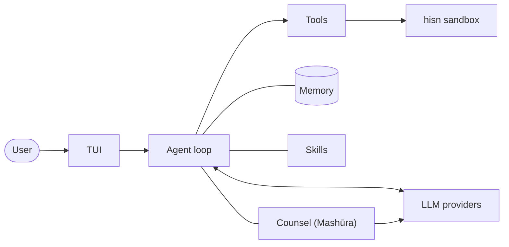

# Wakil

<p align="center">
  
</p>

Wakil is a terminal agentic coding assistant. It runs its tools in a [hisn](https://github.com/treeol/hisn) sandbox, works with the model endpoints you configure, and keeps memory and skills between sessions.

[](go.mod)
[](https://github.com/treeol/wakil/releases)
[](LICENSE)
[](https://github.com/treeol/wakil/actions/workflows/ci.yml)
[](https://github.com/treeol/wakil/actions/workflows/govulncheck.yml)

## Why

By default every tool call runs in a sandbox, and shell commands and workspace writes ask for confirmation unless you turn on auto-approval; destructive commands stay gated even then. Second opinions come from Mashūra, which sends reviews, debugging questions and decisions to other models you configure. Memory persists per project and skills are shared across projects, so a new session starts with what earlier ones learned. Start is fast: 149 ms from launch to prompt (rubin, khatam repo, [docs/PERF-0.6.md](docs/PERF-0.6.md)), and exit has been near-instant since the ilm emitter was removed.

## Architecture



- **TUI:** `internal/tui` (Bubble Tea terminal UI). `internal/wiring` bootstraps it and the headless `wakil run`.
- **Agent loop:** `internal/agent` (turns, tool dispatch, subagents, slash commands) and `internal/workflow` (the `/plan` state machine).
- **Tools and execution:** `internal/tools` defines the tools; `internal/exec` runs them on a sandbox backend (hisn, docker or direct).
- **Sandbox:** `internal/sandbox` is the backend-neutral contract; `internal/sandbox/hisn` drives the hisn CLI and control socket.
- **Counsel:** `internal/counsel` calls and combines the external models.
- **Memory and skills:** `internal/memory` is the durable store (memory entries and the skill store); `internal/staging` is the ephemeral key-value store.
- **LLM providers:** `internal/proxy` is the model client; `internal/orregistry` supplies model metadata.

## Quick install

For the impatient (Linux and macOS, amd64 and arm64). Download the script, read it if you like, then run it:

```sh
curl -fsSL https://github.com/treeol/wakil/releases/latest/download/install.sh -o install.sh && sh install.sh
```

The shorter piped form does the same, but you run the script without reading it first:

```sh
curl -fsSL https://github.com/treeol/wakil/releases/latest/download/install.sh | sh
```

What `install.sh` does:

- Installs the latest Wakil release (or `--version vX.Y.Z`) into `~/.local/bin` (or `--prefix DIR` / `$WAKIL_INSTALL_DIR`) and warns if that directory is not on your `PATH`. It never edits your shell rc files.
- Verifies every download against the sha256 sums published with its release **before** anything is extracted or made executable, and aborts with nothing installed on a mismatch. If `cosign` is installed it also verifies the signature of `checksums.txt`; `--require-signature` makes that mandatory.
- On Linux, installs hisn 0.4.1 (the `gnu` build when glibc is 2.35 or newer, else the x86_64 `musl` build, which is not leak-tested) unless a new enough hisn is already on your `PATH`, and runs `hisn check`. If hisn cannot run here, Wakil falls back to Docker.
- On Linux with root (or `sudo`, or `--sudo`), also installs the optional kvr-server 0.2.0 into `/usr/local/bin`, where the hisn sandbox can see it; without root it is skipped and staging stays off.
- If `~/.config/wakil/config.json` does not exist, offers a quickstart OpenRouter config (`config.quickstart.json`) using `$OPENROUTER_API_KEY`, or a key typed at the prompt (hidden, written with mode 0600). It never overwrites an existing config; `--no-config` skips it. The quickstart model is a free one: it shows that Wakil runs, but is weak at tool calling.

Then `cd your-project && wakil .`. `sh install.sh --help` lists all options; `--uninstall` removes only what the script installed and leaves your config and data. The manual steps below remain the reference path.

## Quickstart

**1. Install Wakil** (Linux and macOS, amd64 and arm64). Take a `.tar.gz`, `.deb`, `.rpm` or `.apk` from the [releases page](https://github.com/treeol/wakil/releases), or build with Go:

```sh
go install github.com/treeol/wakil/cmd/wakil@latest
```

A release binary is pinned to a sandbox image by digest; a `go install` build is not (see `wakil version`). To verify a release, download `checksums.txt` and `checksums.txt.sigstore.json` from the same release:

```sh
cosign verify-blob checksums.txt \
  --bundle checksums.txt.sigstore.json \
  --certificate-identity-regexp '^https://github.com/treeol/wakil/\.github/workflows/release\.yml@refs/tags/v' \
  --certificate-oidc-issuer https://token.actions.githubusercontent.com
sha256sum --check --ignore-missing checksums.txt
```

**2. Install hisn 0.4.1**, the minimum Wakil supports. hisn publishes Linux binaries on its [v0.4.1 release](https://github.com/treeol/hisn/releases/tag/v0.4.1); use `hisn-aarch64-linux-gnu` on arm64.

```sh
V=https://github.com/treeol/hisn/releases/download/v0.4.1
curl -fsSLO "$V/hisn-x86_64-linux-gnu" && curl -fsSLO "$V/SHA256SUMS"
sha256sum --check --ignore-missing SHA256SUMS
sudo install -m 0755 hisn-x86_64-linux-gnu /usr/local/bin/hisn
hisn check
```

Wakil uses hisn when it is 0.4.1 or newer, `hisn check` passes and you chose no backend; otherwise it falls back to Docker, and the startup banner says why. `--sandbox direct` runs with no sandbox at all, and the confirmation prompt stays on.

**3. Point it at a model** in `~/.config/wakil/config.json` (Wakil creates a commented stub there on first run):

```json
{
  "endpoints": {
    "local": { "kind": "openai", "base_url": "http://localhost:8080", "model": "qwen3.6-35b" }
  },
  "default_endpoint": "local"
}
```

**4. Run it** in a project, or pass the project directory as an argument. `wakil doctor` checks the container runtime, config and image.

```sh
cd ~/projects/myapp && wakil
```

Three things to know in the prompt:

- `/new` starts a fresh conversation.
- `/help` lists every slash command.
- **Skills have no slash command.** Wakil matches your message against the skill store and injects up to two matching skills into the turn. The model can also load one with its `load_skill` tool. `/skill-create <topic>` writes a new one and `/skills` reviews drafts. Details: [docs/tui.md](docs/tui.md#using-skills).

## Features

| Feature | What it does | Docs |
|---|---|---|
| Sandboxed tools | Shell, file and background-process tools run in hisn, Docker or (opt-out) directly on the host; per-project additions need `wakil sandbox trust` | [sandbox-backends.md](docs/sandbox-backends.md), [tools.md](docs/tools.md) |
| Counsel (Mashūra) | `review`, `debug`, `decide` and `check` tools query named panels of external models; off until `oracle_enabled` is set | [features.md](docs/features.md#counsel-mashūra) |
| Memory | Durable memory in two tiers with taint tracking, plus an ephemeral staging store | [memory.md](docs/memory.md), [staging.md](docs/staging.md) |
| Skills | A global store of reference documents and file templates; automatic creation is off by default | [tools.md](docs/tools.md#skill-templates), [tui.md](docs/tui.md#using-skills) |
| Trace and perf | JSONL session traces, and a phase timeline for start, `/new`, `/resume` and exit | [features.md](docs/features.md#trace-capture), [PERF-0.6.md](docs/PERF-0.6.md) |
| Subagents | Discovery, edit and tools workers; edit workers use isolated git worktrees in git repositories | [tools.md](docs/tools.md#subagents) |
| MCP connectors | Tools from MCP servers (stdio or HTTP) listed under `mcp_servers`; `/mcp` shows them | [configuration.md](docs/configuration.md), [tools.md](docs/tools.md) |
| `/plan` and headless | A gather, plan, review, implement workflow; `wakil run` runs one task without the TUI and exits with a code | [tui.md](docs/tui.md#plan-workflow), [headless.md](docs/headless.md) |

## Configuration

The config file is JSON at `~/.config/wakil/config.json`; `WAKIL_CONFIG` or `--config` point elsewhere. Precedence is defaults, then file, then environment, then flags. The keys most people set first:

- `endpoints` and `default_endpoint`: the model endpoints and which one starts active.
- `sandbox.backend`: `docker`, `hisn` or `direct`. Unset means hisn when usable, else Docker.
- `oracle_enabled`: turns on the Mashūra counsel tools.
- `context_mode`: `long-session` (default) collapses finished requests to a question and answer; `standard` sends the full history.

All keys, flags and subcommands are in [docs/configuration.md](docs/configuration.md); [config.example.json](config.example.json) is a commented reference. [docs/README.md](docs/README.md) indexes the rest of the documentation.

## Development

```sh
go build -o wakil ./cmd/wakil
go vet ./...
golangci-lint run
go test -count=1 -cover ./... | tee cover.txt
scripts/check_coverage.sh cover.txt   # coverage floors for the damage-critical packages
scripts/check_config_docs.sh          # every config.example.json key is documented
```

The race detector, the real-hisn integration tests and the CI gates are described in [CONTRIBUTING.md](CONTRIBUTING.md). Architecture decisions are in [docs/adr](docs/adr/README.md).

## Status and roadmap

The current release is 0.6.0; see [CHANGELOG.md](CHANGELOG.md). Open work is tracked in [docs/follow-ups.md](docs/follow-ups.md) and under "Known follow-ups" in the 0.6.0 changelog entry.

## License

Apache License 2.0. See [LICENSE](LICENSE).
