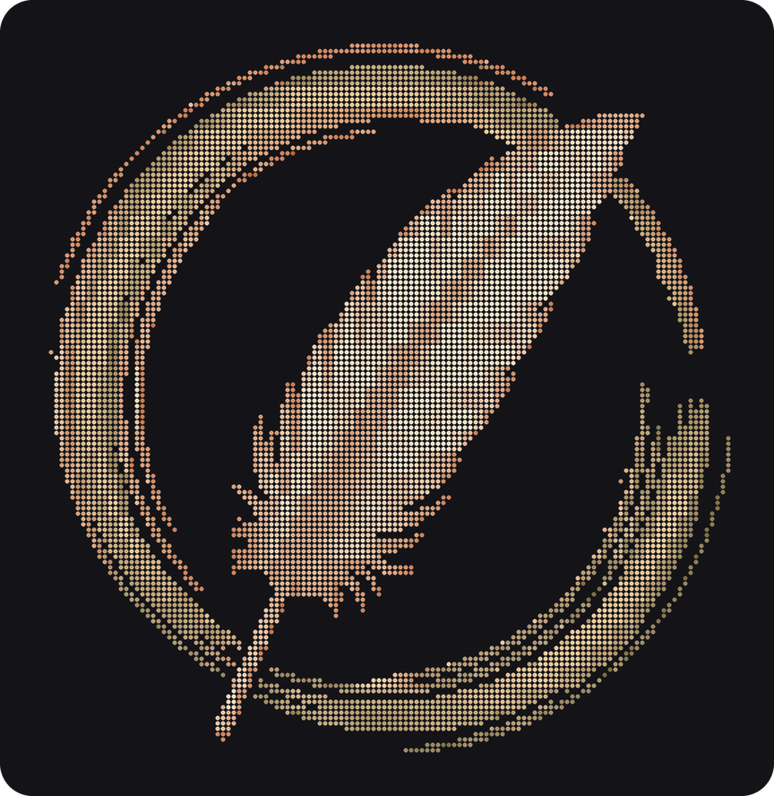

# wakīl

<p align="center">
  
</p>

wakīl is an AI coding agent for your terminal. Describe what you want built,
fixed or understood, and it works through your codebase alongside you: reading
and changing code, running commands safely in an isolated sandbox, and
remembering your project from one session to the next. It works with the AI
model of your choice, and your sessions and project knowledge stay on your own
machine.

[](https://go.dev)
[](LICENSE)
[](https://github.com/treeol/wakil/actions/workflows/ci.yml)
[](https://github.com/treeol/wakil/actions/workflows/govulncheck.yml)

## Install

Linux and macOS (amd64, arm64). Docker or Podman is needed for the default sandbox.

| Method | Command |
|---|---|
| GitHub Releases | `.tar.gz`, `.deb`, `.rpm`, `.apk` from the [releases page](https://github.com/treeol/wakil/releases), e.g. `sudo dpkg -i wakil_*_linux_amd64.deb` or `sudo rpm -i wakil_*_linux_amd64.rpm` |
| Go | `go install github.com/treeol/wakil/cmd/wakil@latest` *(dev build: not paired with a pinned sandbox image)* |

Packages only install `/usr/bin/wakil` — no scripts, no network access at install
time. Each release binary is pinned to one sandbox image **by digest**
(`ghcr.io/treeol/wakil-sandbox@sha256:…`, see `wakil version`) and pulls it on
first run. `wakil doctor` checks your container runtime, config and image.

**Verify a release** (download `checksums.txt`, `checksums.txt.sigstore.json` and your artifact from the same release, e.g. `v0.3.0`):

```sh
# checksums.txt is signed keyless with cosign (GitHub Actions OIDC identity)
cosign verify-blob checksums.txt \
  --bundle checksums.txt.sigstore.json \
  --certificate-identity-regexp '^https://github.com/treeol/wakil/\.github/workflows/release\.yml@refs/tags/v' \
  --certificate-oidc-issuer https://token.actions.githubusercontent.com
sha256sum --check --ignore-missing checksums.txt

# build provenance attestation for any artifact
gh attestation verify wakil_*_linux_amd64.tar.gz --repo treeol/wakil

# the sandbox image is signed too (digest from `wakil version`)
cosign verify ghcr.io/treeol/wakil-sandbox@sha256:<digest> \
  --certificate-identity-regexp '^https://github.com/treeol/wakil/\.github/workflows/release\.yml@refs/tags/v' \
  --certificate-oidc-issuer https://token.actions.githubusercontent.com
```

## Quickstart

Prerequisites: [Go 1.26+](https://go.dev) *(only to build from source)*, Docker, and a running model endpoint.

```sh
# 1. Build — single Go executable (or install a release, see above)
go build -o wakil ./cmd/wakil

# 2. Sandbox image: release binaries pull their pinned image automatically.
#    For a source build, build the dev image (Go, Node, Rust, Python + gopls):
docker build -t wakil-dev .

# 3. Configure your endpoint
mkdir -p ~/.config/wakil
cat > ~/.config/wakil/config.json << 'EOF'
{
  "endpoints": {
    "local": {
      "kind": "openai",
      "base_url": "http://localhost:8080",
      "model": "qwen3.6-35b"
    }
  },
  "default_endpoint": "local"
}
EOF

# 4. Run — workspace arg is optional, defaults to cwd
./wakil ~/projects/myapp
```

No Docker? Run with `--exec direct` — the confirmation gate stays on.
See [docs/endpoints.md](docs/endpoints.md) for other providers and
[config.example.json](config.example.json) for all options.

## What it can do

- **Code work, end to end** — file tools, sandboxed shell, LSP-backed symbol
  navigation, and a headless browser for visual checks.
- **Confirmation-first execution** — every command and workspace mutation
  prompts before it runs; reads proceed without prompting. Even in auto mode,
  destructive operations stay gated.
- **Long-session memory** — finished turns collapse to a question + answer +
  archive note, so context grows only when the current work needs it. Durable
  per-workspace memory recalls decisions and architecture across sessions.
- **Parallel subagents** — discovery, edit, and tool-use workers; edits run in
  isolated git worktrees.
- **Second opinions** — multi-model counsel on reviews, bugs, and decisions,
  with keys read at call time and never stored.
- **Plays well with your stack** — MCP tools, `AGENTS.md` conventions, repo
  map injection, lifecycle hooks, cost tracking, and full JSONL traces.
- **Scales to a daemon** — `./wakil daemon` serves multiple clients with a
  built-in web console ([docs/remote-provisioning.md](docs/remote-provisioning.md)).

## Security

wakil executes commands and writes files. The confirmation gate is the primary
defense. Docker mode adds a read-only rootfs, dropped capabilities, and
resource limits — convenience-grade isolation, not adversarial-grade. Tools
you configure (endpoints, counsel models, MCP servers, search) can send data
externally. See [SECURITY.md](SECURITY.md) for the threat model and hardening
checklist.

## Explore

| Topic | Document |
|---|---|
| Configuration | [docs/configuration.md](docs/configuration.md) |
| Endpoints | [docs/endpoints.md](docs/endpoints.md) |
| Tools & subagents | [docs/tools.md](docs/tools.md) · [docs/features.md](docs/features.md) |
| TUI commands | [docs/tui.md](docs/tui.md) · type `/` in the TUI for the command picker, `/help` for the full list |
| Memory & context modes | [docs/memory.md](docs/memory.md) · [context modes](docs/configuration.md#config-only-fields) (`context_mode`, `/mode`) |
| Daemon | [docs/remote-provisioning.md](docs/remote-provisioning.md) |
| Security | [SECURITY.md](SECURITY.md) |
| Contributing | [CONTRIBUTING.md](CONTRIBUTING.md) |

## Status

Early-stage. Config keys, session format, and the tool set may change between
commits.

## License

Apache License 2.0 — see [LICENSE](LICENSE).
