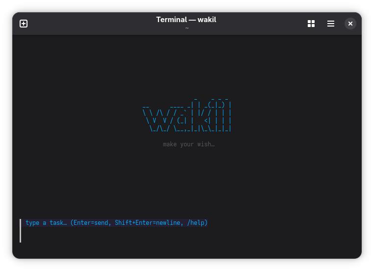

# wakīl

<p align="center">
  
</p>

[](https://github.com/treeol/wakil/actions/workflows/ci.yml)
[](https://github.com/treeol/wakil/actions/workflows/govulncheck.yml)
[](LICENSE)
[](https://go.dev)

**Your terminal. Your model. Your coding agent.**

wakīl reads and edits code, runs commands, and remembers your project across
sessions — connecting to any OpenAI-compatible Chat Completions endpoint you
bring (llama.cpp, OpenRouter, vLLM, Ollama). No hosted control plane; sessions,
memory, and traces stay on your disk.

## Quickstart

Prerequisites: [Go 1.26+](https://go.dev), Docker, and a running model endpoint.

```sh
# 1. Build — single Go executable
go build -o wakil ./cmd/wakil

# 2. Build the sandbox image (Go, Node, Rust, Python + gopls, baked in)
docker build -t wakil-dev .

# 3. Configure your endpoint
mkdir -p ~/.config/wakil
cat > ~/.config/wakil/config.json << 'EOF'
{
  "endpoints": {
    "local": {
      "kind": "openai",
      "base_url": "http://localhost:8080",
      "model": "qwen3.6-35b"
    }
  },
  "default_endpoint": "local"
}
EOF

# 4. Run — workspace arg is optional, defaults to cwd
./wakil ~/projects/myapp
```

No Docker? Run with `--exec direct` — the confirmation gate stays on.
See [docs/endpoints.md](docs/endpoints.md) for other providers and
[config.example.json](config.example.json) for all options.

## What it can do

- **Code work, end to end** — file tools, sandboxed shell, LSP-backed symbol
  navigation, and a headless browser for visual checks.
- **Confirmation-first execution** — every command and workspace mutation
  prompts before it runs; reads proceed without prompting. Even in auto mode,
  destructive operations stay gated.
- **Long-session memory** — finished turns collapse to a question + answer +
  archive note, so context grows only when the current work needs it. Durable
  per-workspace memory recalls decisions and architecture across sessions.
- **Parallel subagents** — discovery, edit, and tool-use workers; edits run in
  isolated git worktrees.
- **Second opinions** — multi-model counsel on reviews, bugs, and decisions,
  with keys read at call time and never stored.
- **Plays well with your stack** — MCP tools, `AGENTS.md` conventions, repo
  map injection, lifecycle hooks, cost tracking, and full JSONL traces.
- **Scales to a daemon** — `./wakil daemon` serves multiple clients with a
  built-in web console ([docs/remote-provisioning.md](docs/remote-provisioning.md)).

## Security

wakil executes commands and writes files. The confirmation gate is the primary
defense. Docker mode adds a read-only rootfs, dropped capabilities, and
resource limits — convenience-grade isolation, not adversarial-grade. Tools
you configure (endpoints, counsel models, MCP servers, search) can send data
externally. See [SECURITY.md](SECURITY.md) for the threat model and hardening
checklist.

## Explore

| Topic | Document |
|---|---|
| Configuration | [docs/configuration.md](docs/configuration.md) |
| Endpoints | [docs/endpoints.md](docs/endpoints.md) |
| Tools & subagents | [docs/tools.md](docs/tools.md) · [docs/features.md](docs/features.md) |
| TUI commands | [docs/tui.md](docs/tui.md) · type `/` in the TUI for the command picker, `/help` for the full list |
| Memory & context modes | [docs/memory.md](docs/memory.md) · [context modes](docs/configuration.md#config-only-fields) (`context_mode`, `/mode`) |
| Daemon | [docs/remote-provisioning.md](docs/remote-provisioning.md) |
| Security | [SECURITY.md](SECURITY.md) |
| Contributing | [CONTRIBUTING.md](CONTRIBUTING.md) |

## Status

Early-stage. Config keys, session format, and the tool set may change between
commits.

## License

Apache License 2.0 — see [LICENSE](LICENSE).
